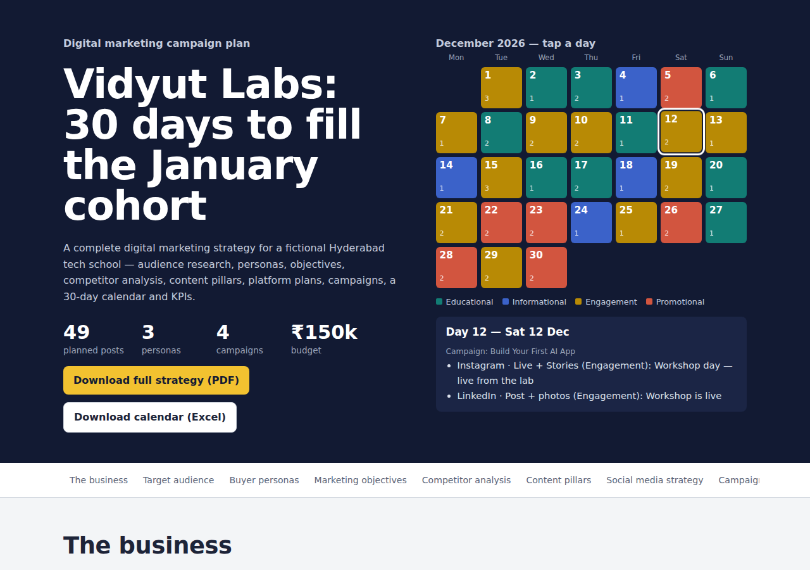

# ⚡ Vidyut Labs — Digital Marketing Campaign Planning & Content Strategy

A complete **30-day digital marketing strategy** for *Vidyut Labs*, a **fictional** Hyderabad-based tech-education business that runs project-based cohorts in AI/ML and Full-Stack Development.

> Internship project — **Digital Marketing** · Prepared by **Reddi Malli Nandini**

**🔗 Live preview:** _add your Netlify link here_  
**📄 Full report:** [`report/Vidyut-Labs-Digital-Marketing-Strategy.pdf`](report/Vidyut-Labs-Digital-Marketing-Strategy.pdf)  
**📅 Content calendar:** [`content-calendar/30-day-content-calendar.xlsx`](content-calendar/30-day-content-calendar.xlsx)



---

## 🎯 Project objective

Learn the fundamentals of digital marketing strategy — audience identification, content planning, platform selection and campaign measurement — by building a full strategy for a fictional technology business.

## 🏢 The business (fictional)

| | |
|---|---|
| **Name** | Vidyut Labs |
| **Industry** | EdTech / tech-skills education |
| **Location** | Madhapur, Hyderabad (online + weekend offline labs) |
| **Offer** | 12-week project-based cohorts (AI/ML, Full-Stack), free workshops, mentor code reviews, placement support |
| **USP** | Every learner ships 4 deployed projects with mentor code review, with doubt-clearing in English and Telugu. |
| **Goal of this plan** | Fill the January 2027 cohort through a 30-day campaign (1–30 Dec 2026) |
| **Budget** | ₹150,000 |

## 📦 Deliverables

| # | Deliverable | File |
|---|---|---|
| 1 | Target audience profile | [01-target-audience.md](strategy/01-target-audience.md) |
| 2 | Buyer personas (3) | [02-buyer-personas.md](strategy/02-buyer-personas.md) |
| 3 | Marketing objectives (SMART) | [03-marketing-objectives.md](strategy/03-marketing-objectives.md) |
| 4 | Competitor analysis + SWOT | [04-competitor-analysis.md](strategy/04-competitor-analysis.md) |
| 5 | Content pillars | [05-content-pillars.md](strategy/05-content-pillars.md) |
| 6 | Social media strategy | [06-social-media-strategy.md](strategy/06-social-media-strategy.md) |
| 7 | 30-day content calendar | [07-content-calendar.md](strategy/07-content-calendar.md) · [Excel](content-calendar/30-day-content-calendar.xlsx) · [CSV](content-calendar/30-day-content-calendar.csv) |
| 8 | Campaign ideas | [08-campaign-ideas.md](strategy/08-campaign-ideas.md) |
| 9 | Content formats | [09-content-formats.md](strategy/09-content-formats.md) |
| 10 | Hashtag & keyword strategy | [10-hashtag-keyword-strategy.md](strategy/10-hashtag-keyword-strategy.md) |
| 11 | Marketing KPI list | [11-marketing-kpis.md](strategy/11-marketing-kpis.md) |
| 12 | Final strategy document | [PDF report](report/Vidyut-Labs-Digital-Marketing-Strategy.pdf) |

Business overview, positioning and budget: [00-business-overview.md](strategy/00-business-overview.md)

## ✨ Strategy highlights

- **3 personas:** Ravi (final-year student), Sneha (career switcher), Srinivas (parent who pays)
- **4 content pillars:** Educational 22% · Informational 22% · Engagement 35% · Promotional 20% — promotion kept to ~20%
- **Platform-specific plans:** Instagram (awareness & community), LinkedIn (credibility & switchers), Website (SEO & conversions), plus YouTube Shorts and WhatsApp as support
- **4 weekly campaigns:**
  1. *Projects > Certificates* — awareness
  2. *Build Your First AI App* — free workshop for lead generation
  3. *#ProjectNotPromise* — 7-day build challenge for UGC
  4. *New Year, New Stack* — enrolment push with an early-bird deadline
- **49-post calendar:** Instagram 28 · LinkedIn 16 · Website 5
- **KPIs across the funnel:** reach → engagement rate → sessions → registrations → CPL → enrolments → CAC/ROAS

### Headline targets (30 days)

| Metric | Target |
|---|---|
| Instagram followers | 1,200 → 3,000 |
| LinkedIn followers | 500 → 1,200 |
| Workshop registrations | 600 |
| Counselling calls | 150 |
| Enrolments | 40 |
| CAC | ≤ ₹3,750 |

## 🗂️ Repository structure

```
.
├── index.html                      # Live preview website (deploy to Netlify / GitHub Pages)
├── README.md
├── LINKEDIN_POST.md                # Ready-to-post LinkedIn caption
├── assets/
│   └── preview.png
├── report/
│   └── Vidyut-Labs-Digital-Marketing-Strategy.pdf   # Final strategy document (19 pages)
├── content-calendar/
│   ├── 30-day-content-calendar.xlsx   # Calendar + KPI Tracker + Keywords + Budget sheets
│   └── 30-day-content-calendar.csv    # Import into Google Sheets
└── strategy/
    ├── 00-business-overview.md
    ├── 01-target-audience.md
    ├── 02-buyer-personas.md
    ├── 03-marketing-objectives.md
    ├── 04-competitor-analysis.md
    ├── 05-content-pillars.md
    ├── 06-social-media-strategy.md
    ├── 07-content-calendar.md
    ├── 08-campaign-ideas.md
    ├── 09-content-formats.md
    ├── 10-hashtag-keyword-strategy.md
    └── 11-marketing-kpis.md
```

## 📊 The Excel workbook

| Sheet | What it does |
|---|---|
| **Content Calendar** | All 49 posts with platform, pillar, format, hook, CTA, hashtags; Status dropdown (Planned → Published); auto summary of pillar mix |
| **KPI Tracker** | Weekly actuals vs targets with automatic % of target, cost per lead and CAC |
| **Keywords & Hashtags** | SEO keywords with intent and priority + a column for your Google Trends check |
| **Budget** | Planned vs actual spend with automatic totals and variance |

To use it in Google Sheets: *File → Import → Upload* the `.xlsx` (or the `.csv`).

## 🛠️ Tools used

Google Sheets / Excel · Google Docs · Canva (creative planning) · Google Trends · Keyword research tools · Instagram, LinkedIn & website planning · HTML/CSS for the live preview

## 🚀 Run / deploy the live preview

- **Locally:** open `index.html` in any browser.
- **Netlify:** go to [app.netlify.com/drop](https://app.netlify.com/drop) and drag this whole folder in.
- **GitHub Pages:** *Settings → Pages → Deploy from branch → `main` / root*.

## 📚 Key learnings

1. **Audience first** — personas decide channels, tone and offers.
2. **Value before selling** — keeping promotion near 20% protects reach and trust.
3. **Platform-native content** — one idea becomes a Reel, a LinkedIn carousel and an SEO article.
4. **Measure and adapt** — UTM links and a weekly KPI review make the calendar a living plan.
5. **Hooks and deadlines drive action** — a free workshop, a 7-day challenge and an early-bird date.

## ⚠️ Disclaimer

Vidyut Labs is a fictional business created for learning purposes. Baseline numbers, targets and budgets are planning assumptions. Competitor observations are general market patterns, not detailed claims about any specific company.

---

**Author:** Reddi Malli Nandini · Digital Marketing Intern
